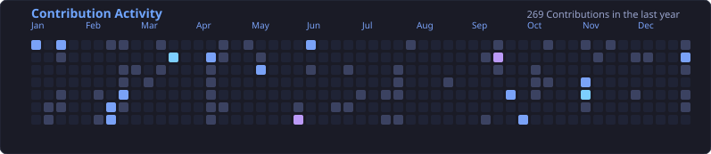
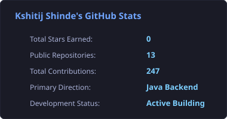
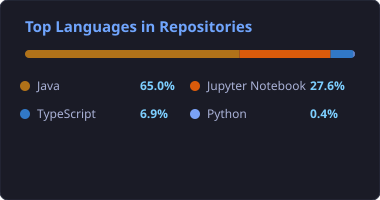

<table>
  <tr>
    <td width="220" align="center" valign="middle">
      
    </td>
    <td valign="middle">
      <h1>👋 Hi, I'm Kshitij Shinde</h1>
      <h3>☕ Java Backend Developer</h3>
      <p><b>Third Year IT Engineering Student</b> &bull; <i>Sanjivani College of Engineering, Kopargaon</i></p>
      <p>I build backend applications using Java and Spring Boot, design REST APIs, work with databases and security, and continuously improve my problem-solving skills through DSA.</p>
      <p><i>“Turning ideas into reliable backend solutions.”</i></p>
      <p>
        <a href="https://github.com/KshitijShinde26"></a>
        <a href="https://www.linkedin.com/in/kshitijshinde26/"></a>
        <a href="https://leetcode.com/u/kshitu_26/"></a>
        <a href="mailto:kshitij26gs@gmail.com"></a>
        <a href="https://www.instagram.com/kshitij_2683/"></a>
      </p>
    </td>
  </tr>
</table>

```java
public class Backend_Developer {
    public static void main(String[] args) {
        build();
        learn();
        improve();
        repeat();
    }
}
```

---

## ⚡ Quick Overview

<table>
  <tr>
    <td width="50%">
      🎓 <b>Third Year IT Engineering Student</b><br/>
      <sub>Learning • Building • Growing (Sanjivani COE)</sub>
    </td>
    <td width="50%">
      💻 <b>Java Backend Development</b><br/>
      <sub>APIs • Databases • Spring Security</sub>
    </td>
  </tr>
  <tr>
    <td width="50%">
      🧠 <b>Problem Solver</b><br/>
      <sub>DSA • LeetCode • Java Algorithms</sub>
    </td>
    <td width="50%">
      🚀 <b>Real Projects</b><br/>
      <sub>Building Practical Server-Side Applications</sub>
    </td>
  </tr>
</table>

---

## ⚙️ Tech Stack

### Languages


### Backend Development


### Database & Persistence


### Tools & Ecosystem


---

## 🚀 Featured Project

### 🛒 [Surplus Food Marketplace Backend](https://github.com/KshitijShinde26/Surplus_Food_MarketPlace_Project)

An enterprise-style Java Spring Boot backend for a surplus food marketplace connecting food providers, consumers, and NGOs to help minimize food waste.

**Core stack:** Java 21, Spring Boot 3.3.5, Spring Security, JWT, Spring Data JPA, Hibernate, MySQL, WebSockets/STOMP, and Maven.

#### Backend Architecture & Highlights
- **Layered architecture:** Controllers, Services, Repositories, Entities, DTOs, and Mappers.
- **Security & authorization:** Stateless JWT authentication and role-based access control for consumers, businesses, NGOs, and admins.
- **Data persistence:** MySQL with Spring Data JPA and Hibernate.
- **Transactions & pooling:** Transaction boundaries and database connection pooling.
- **Real-time notifications:** WebSockets/STOMP for live alerts.
- **Validation & monitoring:** Request validation and Actuator health endpoints, as implemented in the project.

**[View Repository →](https://github.com/KshitijShinde26/Surplus_Food_MarketPlace_Project)** · **[Live App Preview →](https://surplus-food-market-place-project.vercel.app)**

---

## 🧠 Data Structures & Algorithms

I practice Data Structures and Algorithms using Java to strengthen problem-solving skills and prepare for technical interviews.

- 💡 **[LeetCode Solutions (Java)](https://github.com/KshitijShinde26/LeetCode)** — Java solutions to coding and algorithmic problems.
- 📚 **[Apna College Data Structures](https://github.com/KshitijShinde26/Apna_College_Data_Structure)** — Stacks, queues, linked lists, trees, recursion, and sorting.
- 🎓 **[College Data Structures](https://github.com/KshitijShinde26/College_Data_Structure)** — Academic implementations and lab exercises.
- ☕ **[Udemy Data Structures in Java](https://github.com/KshitijShinde26/Udemy_Data_Structure_Java)** — Course-driven data structure practice.

**[Visit my LeetCode profile →](https://leetcode.com/u/kshitu_26/)**

---

## 📁 Other Projects

- 🧁 **[Payel's Bakery Cottage](https://github.com/KshitijShinde26/Payel-s_Bakery_Cottage)** — Bakery e-commerce application with product catalogs, order flows, and role-based dashboards.
- 💼 **[Personal Portfolio](https://github.com/KshitijShinde26/Portfolio)** — Personal portfolio website.
- 🎮 **[Game](https://github.com/KshitijShinde26/Game)** — Interactive software project.
- ☕ **[Java Course](https://github.com/KshitijShinde26/Java_Course)** — Core Java, OOP principles, and collections practice.
- 📘 **[Udemy Java Basics](https://github.com/KshitijShinde26/Udemy_Java_Basic)** — Java fundamentals, exception handling, and object modeling.
- 🧩 **[Full Stack Course](https://github.com/KshitijShinde26/Full_Stack_Course)** — Course-based development and service integration exercises.

---

## ⚡ Current Focus

- Building REST APIs using Java and Spring Boot.
- Deepening understanding of Spring Security, JWT, and role-based access control.
- Strengthening database design and persistence with Spring Data JPA and Hibernate.
- Learning API Gateway and microservices architecture.
- Practicing DSA and algorithmic problem-solving using Java.
- Building practical applications with maintainable backend architecture.

---

## 📊 GitHub Activity

<div align="center">



<br/><br/>

<a href="https://github.com/KshitijShinde26">
  
</a>
<a href="https://github.com/KshitijShinde26">
  
</a>

<br/><br/>

<a href="https://github.com/KshitijShinde26">
  
</a>

</div>

---

## 📈 GitHub Stats


## 🏆 GitHub Trophies


### ✍️ Random Dev Quote


### 🔝 Top Contributed Repositories


---

## 🏆 Achievements & Certifications

- 🎓 **Bachelor of Engineering in Information Technology (Third Year)** — Sanjivani College of Engineering, Kopargaon.
- 📜 **Java Backend Development Track** — Continuing to build projects and strengthen backend development skills.

---

## 🤝 Connect With Me

<div align="center">

[](https://github.com/KshitijShinde26)
[](https://www.linkedin.com/in/kshitijshinde26/)
[](https://leetcode.com/u/kshitu_26/)
[](mailto:kshitij26gs@gmail.com)
[](https://www.instagram.com/kshitij_2683/)

<br/>

*“Consistent effort builds extraordinary results.”*

</div>

---

